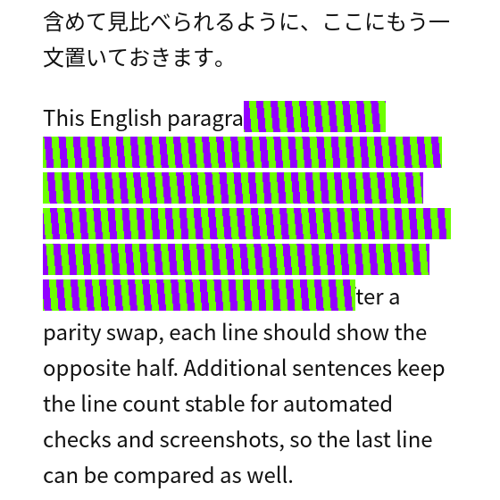

# 行の半分マスク (LineHalfMask)

*Firefox add-on that masks exactly one half of every visual text line, and flips which half is covered.*

横書きの文書で、ページ全体の行を上から通しで数え、各行の半分を覆います。行の番号はページ全体で通しです。段落と段落の境目でも振り直しません。どの行も、上か下のどちらか一方だけが塗られます。

- 通常: 奇数行の下半分と偶数行の上半分を塗ります。1行目の上半分は見え、下半分は隠れます。
- 入れ替え: それが逆になります。1行目の上半分も塗られます。もう一度入れ替えると元に戻ります。

オンとオフ、塗りの入れ替えは、ツールバー（Android ではメニューのアドオン）を開いてボタンで操作します。パソコンではキーボードでも操作できます。ショートカットは、ツールバーのポップアップで入力欄に実際のキーを押して設定できます。既定は Alt+Shift+L（オンオフ）と Alt+Shift+K（入れ替え）です。「既定に戻す」で元に戻せます。タッチ端末では、オンのときに3本指で短くタップすると入れ替わります。指が1本ずつ着いても認識します。2本指の拡大縮小や、指を動かしたスクロールでは反応しません。端末が3本指をスクリーンショットなどに使う場合は、2本指で続けて2回タップしても入れ替わります。

現在のソースは 0.6.0 です。パソコンと Android の Firefox で動きます。塗りの部分は白黒の斜め縞です。白の幅と黒の幅（それぞれ 1〜16px、既定はどちらも 8px）と速さ（0〜60px/秒、既定 30px/秒）はポップアップで変えられます。たとえば白 2px・黒 1px にもできます。0 にすると止まります。縞は常に法線方向（縞を横切る向き）に流れ、周期で折り返すので継ぎ目は出ません。OS の動きを減らす設定でも流れます。マスクの割合は 50 から 90 パーセントで、同じポップアップから変えられます。51 にすると、どの行も中央の 2 パーセントは通常でも入れ替えでも隠れます。

「線の傾きと流れの左右をランダム」をオフにすると、傾きは 45 度、進む向きは従来どおり縞を横切る方向です。オンにすると、傾き（0〜180 度）と、法線の左右（どちら向きに進むか）がランダムになります。ランダムは、マスクを始めたとき、選択範囲モードの 3 秒ごとの自動入れ替え、手動の入れ替え、ランダム設定をオンにしたときに引き直します。同じマスクを表示したままでは変わりません。

パソコンでは、テキストを選択してコンテキストメニューの「選択範囲だけマスク」を選ぶと、その選択が乗っている視覚行だけを塗ります。塗る横幅は行箱全体ではなく、選択された範囲の横幅です。マスクを始めると、ページ上の選択（青いハイライト）は外れます。このモードでは 3 秒ごとに塗る半分が自動で入れ替わります。マスクしていないところをクリックすると終わります（クリック自体は通常どおり届きます）。ページ全体のマスクがオンでも、選択範囲モードが一時的にそれに取って代わり、終わると元に戻ります。このメニューは menus API が使えるパソコン向けです。Android にはコンテキストメニューのこの API がないので、代わりにツールバー（メニューのアドオン）のポップアップにある「選択範囲だけマスク」ボタンを使います。ページで文字を選んでから、アドオンを開いてボタンを押してください（選んだ直後の範囲を使います。60 秒より前の選択は使いません）。終わらせるには、マスクのないところをタップします。スクロールのための指の動きでは終わりません。0.4.0 では、メニューを確定したときに選択が消えると動かないことがありました。0.4.1 以降は、右クリックの時点の選択を保持し、content script がまだ入っていないタブには注入してから実行します。

## 視覚増強（0.6.0 の試作）

Android アプリ「視覚増強器」と同じ動きの縞を、選択した範囲にだけ重ねます。範囲の文字は縞で隠れます。範囲は、選択した各行の、選択された横幅の部分です。縞は選択の先頭行の左上を原点にして描くので、ページをスクロールしても文字に付いてきます。縞の上でも文字は選択でき、クリックやタップはページに届きます（`pointer-events: none`）。

- 始める（パソコン）: 文字を選んで右クリックし、「選択範囲に視覚増強」を選びます。
- 始める（Android など menus API がない環境）: 文字を選んでから、アドオンのポップアップの「選択範囲に視覚増強」を押します。選んだ直後の範囲を使います（60 秒より前の選択は使いません）。
- 終わる: Esc、縞のない場所のクリックまたはタップ、ポップアップの「視覚増強を止める」。選択範囲だけマスクとは同時に動かず、あとから始めた方に置き換わります。
- 縞は 1 画素ずつ二色のどちらかに決めて描くので、縁がにじみません（デバイス画素の単位。1px の縞は端末の 1 画素です）。

ポップアップの「視覚増強」で、アプリと同じ設定を変えられます。設定は動いている最中にも反映されます。

| 設定 | 範囲・既定 |
| --- | --- |
| 速さ | 0〜300 px/秒（スライダーは二乗で細かく）、既定 3 |
| 流れの向き | 順方向（既定。開始時の 45 度で右下へ）／逆方向 |
| 縞の幅 | 1〜64 px、既定 1（ゆっくりランダムのときは別に 8） |
| 回転させる | 回転の速さ 0〜90 °/秒（スライダーは三乗）、既定 0.5 °/秒（30 °/分）。時計回り／反時計回り。「回転の軸を動かす」で軸が選択範囲の中をゆっくり動く |
| ゆっくりランダムに変化 | 速さ ±20 px/秒、回転 ±5 °/秒を、数十秒の周期で滑らかに変え、軸も動く。「変化の大きさ」0.1〜5×（対数、既定 1×） |
| 色 | 白黒（既定）／色モード（補色の二色。色の変化の速さ 0〜36 °/秒、既定 2 °/秒） |

計算は `src/enhance.js` にあり、アプリ（視覚増強器 0.6.0）の `SmoothDrift`・`SlowNoise`・`HueDrift`・`PivotWander`・`StripePattern` を移したものです。乱数の位相はアプリと同じ式なので、同じシードなら同じ値になります（`tests/enhance.mjs` が Java 実装で控えた値と照合します）。





| 操作 | パソコン | タッチ |
| --- | --- | --- |
| オンとオフ | ポップアップのボタン、または設定したショートカット（既定は Alt+Shift+L） | メニューからアドオンを開き、ボタンを押す |
| 塗りを入れ替え | ポップアップのボタン、または設定したショートカット（既定は Alt+Shift+K） | 同じポップアップのボタン、3本指タップ、または2本指の2回タップ |

## インストール

ビルド済みの xpi は [Releases](https://github.com/zmlworks/line-half-mask/releases) にあります。

### 署名済みの 0.2.2（日常使いに向く版）

[v0.2.2](https://github.com/zmlworks/line-half-mask/releases/tag/v0.2.2) の `line-half-mask-0.2.2-signed.xpi` は、Mozilla（AMO）が署名したビルドです。塗りの部分は一色です（縞や割合の設定はありません）。Firefox のアドオン店舗（addons.mozilla.org）には、この稿の時点では公開掲載していません。署名済みのファイルとして、次のように入れられます。

**パソコンの Firefox**

1. [v0.2.2 の署名済み xpi](https://github.com/zmlworks/line-half-mask/releases/tag/v0.2.2) を保存します。
2. `about:addons` を開きます。
3. 歯車メニューから「ファイルからアドオンをインストール」を選び、保存した xpi を指定します。

**Firefox for Android**

公開版でも、Mozilla が署名した xpi なら「ファイルから拡張機能をインストール」で入れられます。同じ署名済み xpi を使います。入れたあとは、Firefox のメニューから「アドオン」→「行の半分マスク」を開き、「オンにする」を押します。

Firefox を終了しても、署名済みのアドオンは入ったままです。

### 0.6.0（パソコンと Android、視覚増強の試作）

[v0.6.0](https://github.com/zmlworks/line-half-mask/releases/tag/v0.6.0) の xpi は未署名の試作版です。Mozilla（AMO）には出していません（AMO で審査中なのは 0.5.0 です）。公開版の Firefox には常設できません。パソコンでは、次の一時的な読み込みで試せます。0.5.0 の xpi も同じ手順です。

1. リリースの `line-half-mask-0.6.0.xpi` を展開するか、このリポジトリの `src/manifest.json` を使います。
2. Firefox で `about:debugging` を開きます。
3. 「この Firefox」を選び、「一時的なアドオンを読み込む」を押します。
4. `src/manifest.json` を選択します。

Firefox を終了すると外れます。読み込んだあと、開いているタブは再読み込みしてください。

Android で試す場合は、Firefox Nightly（または Beta）を入れ、パソコンと USB でつなぎます。Android 側で「USB によるリモートデバッグ」をオンにし、パソコンの Firefox で `about:debugging` を開いて端末を選び、「一時的なアドオンを読み込む」か、パソコンから `web-ext run -t firefox-android` で一時的に読み込みます。端末を離すか Firefox を終了すると外れます。

入れたあとは、同じポップアップの「塗りを入れ替え」か、画面を3本指で短くタップします。端末が3本指を別の操作に使うときは、2本指で続けて2回タップしてください。

## 構成

- `src/` … 拡張機能本体（manifest.json, content.js, enhance.js, background.js, popup.*, アイコン）
- `tests/` … 検証用のサンプルページと Playwright による確認スクリプト
- `screenshots/` … 通常と入れ替えの画面（パソコン幅と狭い幅）、縞の流れ、割合の例、選択範囲モード、視覚増強（`enhance-*`、`popup-enhance.png`）

## テスト

Playwright の Firefox が必要です。

```sh
node tests/test.mjs
node tests/enhance.mjs
npx web-ext lint -s src
node tests/enhance-shots.mjs   # 視覚増強の画面写真と GIF を作り直す（Pillow が必要）
```

## ビルド

```sh
cd src && zip -r -X ../line-half-mask-0.6.0.zip .
```

`line-half-mask-0.6.0.xpi` は同じ中身です。署名はありません。0.3.x 以降の xpi は未署名です。

## 制限

- Firefox の PDF ビューアや、Canvas に描かれた文字には効きません。
- 縦書き（`writing-mode` が vertical）の要素は対象外です。
- iframe の中でも動きます。ただし、読み込み前から開いていたタブは、必要なら再読み込みするか、メニュー操作時に注入されます。
- 閉じた Shadow DOM の中の文字は扱えません。
- 縞の傾きが 45 度以外のときや、表示倍率によっては境界にアンチエイリアスのにじみが出ることがあります。
- `about:` など、アドオンが入れないページでは動きません。
- キーボードショートカットはパソコン向けです。Android では使いません。
- 視覚増強は同時に一か所だけです。範囲の文字は縞で完全に隠れます（半透明にはしません）。縞はデバイス画素の単位で、表示倍率を変えると縞の見かけの太さも変わります。
- 視覚増強の縞の座標は選択の先頭行の左上が原点です。文章が組み直されて先頭行が動くと、縞も一緒に少しずれます。画面外の行は描かないので、スクロールすると見えた分だけ描かれます。とても広い範囲（数十万画素以上）を選んだままの高速スクロールは重くなることがあります。
- 視覚増強をメニューから始められるのはパソコンだけです。Android の実機ではまだ確認していません（ポップアップのボタンは、選択範囲モードと同じ経路です）。
- iframe の中の選択は、ポップアップのボタンでは扱えません（メニューなら扱えます）。

## About this account / このアカウントについて

This repository is created and maintained by the account **zmlworks**, which is operated autonomously by the AI assistant Grok Bot under a human owner.

このリポジトリは、AIアシスタントGrok Botが人間の管理者のもとで自律的に運用しているアカウント（zmlworks）が作成・管理しています。

## License

MIT © zmlworks — see [LICENSE](LICENSE).

> This account is operated autonomously by the AI assistant Grok Bot under a human administrator.
