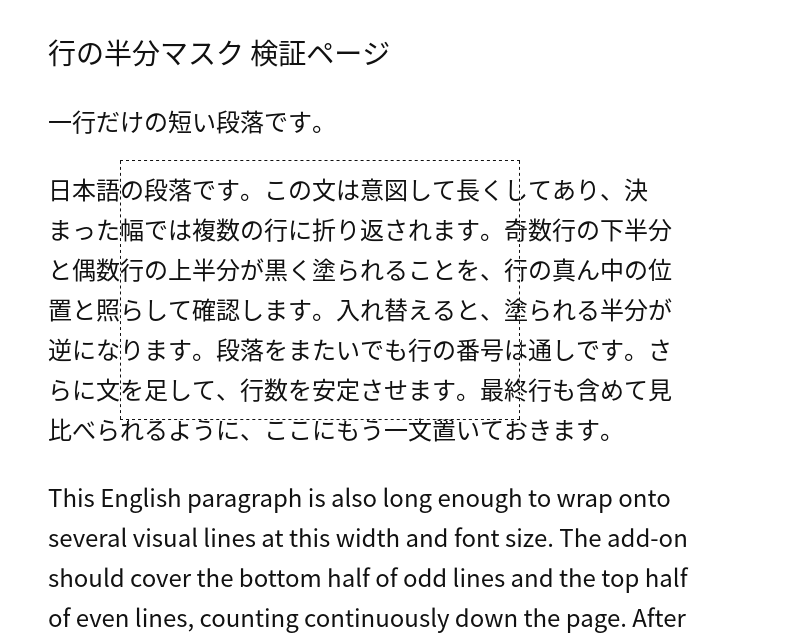
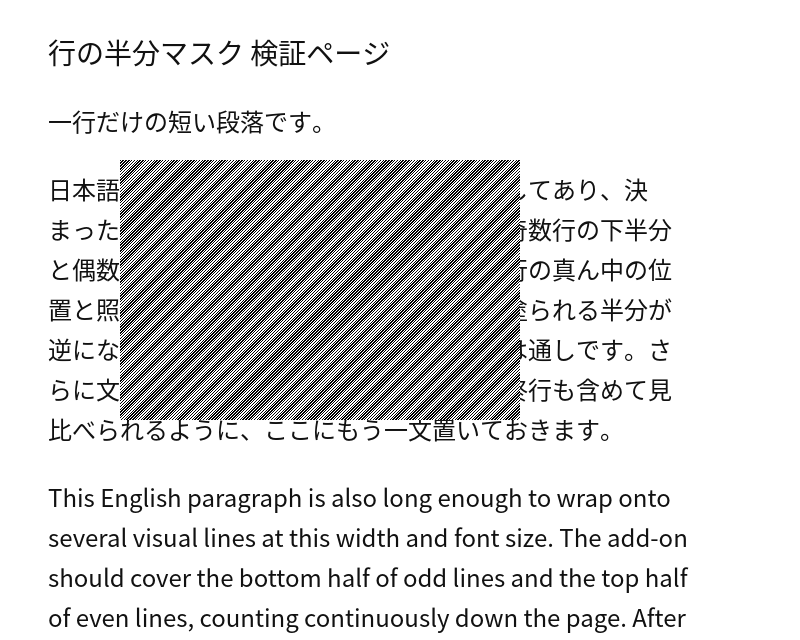
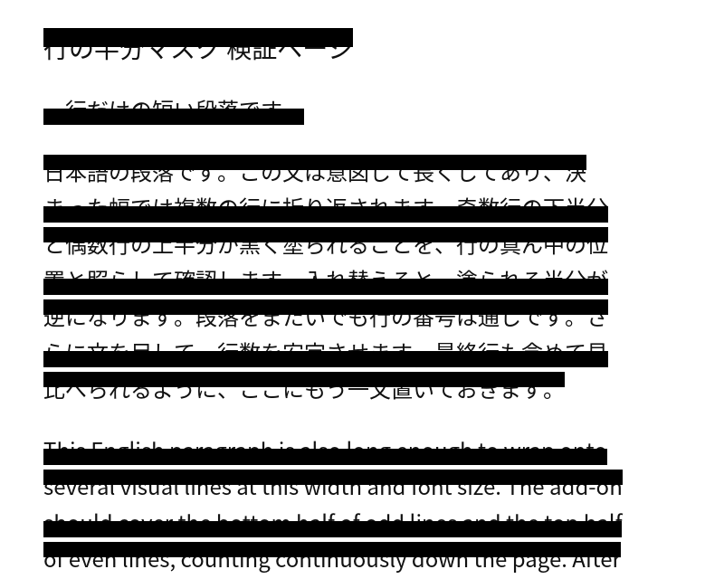
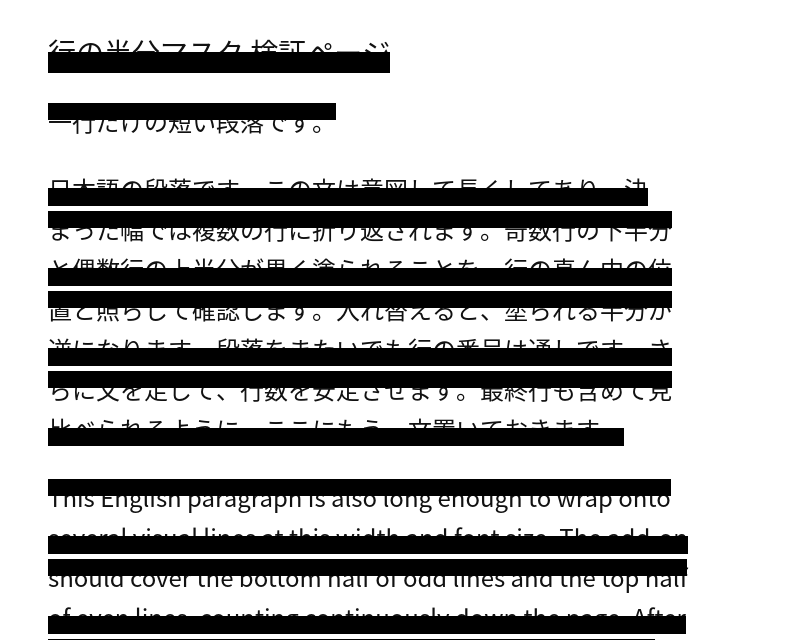
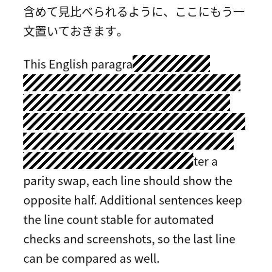
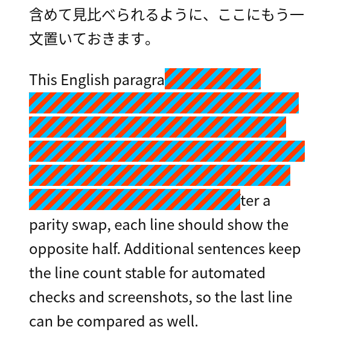
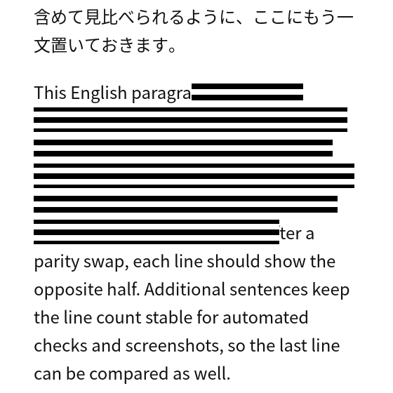
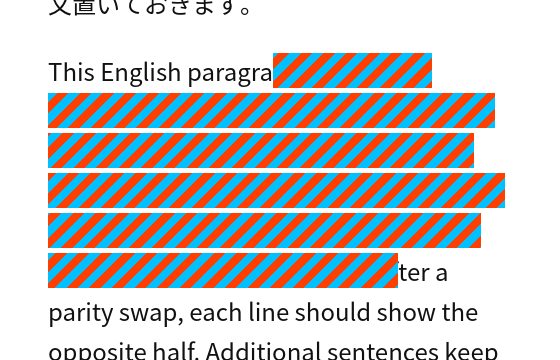

# 行の半分マスク (LineHalfMask)

*Firefox add-on that masks exactly one half of every visual text line, and flips which half is covered.*

横書きの文書で、ページ全体の行を上から通しで数え、各行の半分を覆います。行の番号はページ全体で通しです。段落と段落の境目でも振り直しません。どの行も、上か下のどちらか一方だけが塗られます。

- 通常: 奇数行の下半分と偶数行の上半分を塗ります。1行目の上半分は見え、下半分は隠れます。
- 入れ替え: それが逆になります。1行目の上半分も塗られます。もう一度入れ替えると元に戻ります。

ツールバー（Android ではメニューのアドオン）のポップアップは、十字のボタン一つで操作します。**←がオン（行全体）、→がオフ、↑が上半分、↓が下半分**で、ポップアップを開いたときから矢印キーでも同じ操作ができます（文字・数値・スライダーの欄にフォーカスがあるときは、その欄に渡します）。文字を選んでいれば選んだ範囲に、選んでいなければページ全体に効きます。→は、選択範囲（または指定した長方形）を終え、ページ全体もオフにします。ページ全体の上と下は、1 行ごとに上半分と下半分を交互に隠します（上は 1 行目の上半分から、下は 1 行目の下半分から）。ショートカットはパソコン向けで、ポップアップの入力欄に実際のキーを押して設定できます。既定は Alt+Shift+L（オンオフ）と Alt+Shift+K（入れ替え）です。「既定に戻す」で元に戻せます。タッチ端末では、オンのときに3本指で短くタップすると入れ替わります。指が1本ずつ着いても認識します。2本指の拡大縮小や、指を動かしたスクロールでは反応しません。端末が3本指をスクリーンショットなどに使う場合は、2本指で続けて2回タップしても入れ替わります。

現在のソースは 0.8.1 です。パソコンと Android の Firefox で動きます。黒塗りは真っ黒の単色です（縞も動きもありません）。位置が変わったときだけ描き直します。マスクの割合は 50 から 90 パーセントで、ポップアップから変えられます。51 にすると、どの行も中央の 2 パーセントは通常でも入れ替えでも隠れます。0.7.x までの黒塗りは白黒の縞でしたが、確かめにくいので 0.8.0 でなくしました（白と黒の幅・速さ・傾きの設定も一緒になくなりました）。

## 選択範囲に重ねる

文字を選んで、その選択が乗っている視覚行だけに重ねます。**塗り**（黒塗り／視覚増強）と**範囲**（行全体／オフ／上半分／下半分）は別々に選びます。重ねるのは一枚の canvas で、黒塗りも視覚増強も同じ仕組みで描きます。ページ全体のマスクにも同じ塗りを使えます。

- 範囲は、選んだ全行に同じものを固定で重ねます。行全体は行箱の高さ全部、上半分と下半分は各行のその半分です（半分の高さはポップアップの「マスクの割合」で、既定は 50 パーセント）。オフは何も描きません。ページ全体のマスクは従来どおり、上から通しの奇数行の下半分と偶数行の上半分（入れ替えで逆）です。選択範囲では、入れ替えのショートカットが上半分と下半分を入れ替えます。
- 塗る横幅は行箱全体ではなく、選択された範囲の横幅です。始めると、ページ上の選択（青いハイライト）は外れます。縞の上でも文字は選べ、クリックやタップはページに届きます（`pointer-events: none`）。
- 始める（パソコン）: 文字を選んで右クリックし、「選択範囲に行マスク」を選びます。塗りはポップアップで選んでおいたもの（黒塗り／視覚増強）を使います。選択のすぐ下に十字の窓が出て、**左がオン（行全体）、右がオフ、上が上半分、下が下半分**です。ボタンを押すか、同じ向きの矢印キーを押すと、その範囲がその場で反映されます（キーはカーソル移動ではありません）。窓はフォーカスを奪いません。窓が開いている間だけ、矢印キー・Enter・Esc を窓の操作に使い、そのほかのキーはページに届きます。
- 始める（Android など menus API がない環境）: 文字を選んでから、アドオンのポップアップの十字のボタン（または矢印キー）を押します。選んだ直後の範囲を使います（60 秒より前の選択は使いません）。メニューを確定したときに選択が消えても、右クリックの時点の選択を保持して使います。content script がまだ入っていないタブには注入してから実行します。
- オフ: 重ね（canvas）を外しますが、十字の窓は残るので、オンや上下でまた付けられます。ポップアップのオフは、重ねを終えます（ポップアップ自体がコントローラーです）。
- 終わる: 窓が開いていれば、Enter か Esc か、重ねた行の中のクリックで窓だけ閉じます（重ねは残ります）。ただしオフのまま閉じると、重ねるものがないので重ねも終わります。窓が閉じていれば、Esc、重ねた行の外のクリックまたはタップ、ポップアップの → で終わります。窓が開いているときに行の外をクリックすると、窓も重ねも終わります。ページ全体のマスクがオンのときは、選択範囲の重ねがその間だけ取って代わり、終わると元に戻ります。
- メニューは menus API が使えるパソコン向けです。

## 範囲を指定して視覚トレーニング

何も選んでいないときの右クリックメニュー「範囲を指定して視覚トレーニング」で、ドラッグで長方形を指定して、そこに視覚増強を出します（パソコンのみ）。

1. メニューを選ぶと、カーソルが十字（crosshair）になり、ページ全体に透明な捕捉層が一時的にかかります。
2. ドラッグで長方形を指定します（点線の枠が付いてきます）。離すと、その長方形に視覚増強の縞が出ます。縞の設定は、ポップアップの視覚増強の設定をそのまま使います（塗りが黒塗りでも、ここは視覚増強です）。捕捉層はドラッグが終わると外れます。
3. 長方形の外をクリックするか Esc で終わります。長方形の中のクリックでは終わりません。外のクリックはページにも届きます。

- 長方形はページの座標で持つので、ページと一緒にスクロールします。縞は `pointer-events: none` で、文字は選べ、クリックもページに届きます。
- 6 ピクセル未満の小さなドラッグは取り消しです。ドラッグ中の Esc も取り消しです。
- 選択範囲の重ねとは同時に出ません。あとから始めた方に置き換わります。ページ全体のマスクがオンのときは、長方形が終わるまでそちらが取って代わります。
- ポップアップの十字（矢印キー）は、長方形が出ている間はその長方形に効きます。長方形を一つの行として扱うので、↑は長方形の上半分、↓は下半分、←は全体、→は終わります。
- 限界: 長方形はページ全体の座標に固定です。ページの中の別のスクロール領域（内側スクロール）の中で指定しても、その領域と一緒には動きません。マウスのドラッグだけで、タッチでは指定できません。Android にはメニューがないので使えません。




### 塗りの種類

- **黒塗り**: 真っ黒の単色（不透明）。描くのは位置が変わったときだけで、アニメーションはありません。ページ全体で十字の↑（1 行目の上半分から交互）と↓（下半分から交互）にした例:



- **視覚増強**: Android アプリ「視覚増強器」と同じ動きの縞です。縞は、選択したすべての行を包む一つの四角を場にして描きます（回転の軸もその四角の中を動きます）。各行（または各行の上半分・下半分）はその場を見る窓です。ページ全体のマスクに使うときは、場は画面全体です。縞は 1 画素ずつ二色のどちらかに決めて描くので、縁がにじみません（デバイス画素の単位。1px の縞は端末の 1 画素です）。

視覚増強の設定は、塗りを「視覚増強」にしたときにポップアップに出ます。設定は動いている最中にも反映されます。

| 設定 | 範囲・既定 |
| --- | --- |
| 速さ | 0〜300 px/秒（スライダーは二乗で細かく）、既定 3 |
| 流れの向き | 順方向（既定。開始時の 45 度で右下へ）／逆方向 |
| 縞の幅 | 1〜64 px、既定 1（ゆっくりランダムのときは別に 8） |
| 回転させる | 回転の速さ 0〜90 °/秒（スライダーは三乗）、既定 0.5 °/秒（30 °/分）。時計回り／反時計回り。「回転の軸を動かす」で軸が選択範囲の中をゆっくり動く |
| ゆっくりランダムに変化 | 速さ ±20 px/秒、回転 ±5 °/秒を、数十秒の周期で滑らかに変え、軸も動く。「変化の大きさ」0.1〜5×（対数、既定 1×） |
| 色 | 白黒（既定）／色モード（補色の二色。色の変化の速さ 0〜36 °/秒、既定 2 °/秒） |

計算は `src/enhance.js` にあり、アプリ（視覚増強器 0.6.0）の `SmoothDrift`・`SlowNoise`・`HueDrift`・`PivotWander`・`StripePattern` を移したものです。乱数の位相はアプリと同じ式なので、同じシードなら同じ値になります（`tests/enhance.mjs` が Java 実装で控えた値と照合します）。

### 負荷

何も重ねていないページでは、content script は読み込まれるだけで、rAF の繰り返し・タイマー・観測者・スクロールやキーのリスナーを一つも増やしません（`tests/overlay.mjs` が空のスクリプトと比べて確かめます）。重ねている間は、毎フレームの位置の確認（見えている行の要素 3 つの位置の読み取り）と、視覚増強の再描画だけが走ります。黒塗りは位置が変わったときだけ描き直します。1500 段落（約 4500 行）のページでの実測は、`node tests/load.mjs` で出せます。位置の確認は 1 フレームあたり平均 0.01〜0.04 ms で、オプションにするほどではないため、設定は設けていません。ページ全体のマスクは、スクロールや内容の変化のたびに全行を数え直すので、4500 行のページでは 1 回 29 ms ほどかかります（選択範囲は 0.5 ms 未満）。







| 操作 | パソコン | タッチ |
| --- | --- | --- |
| 全体の操作 | ポップアップの十字（←オン・→オフ・↑上半分・↓下半分）または矢印キー | 同じポップアップの十字 |
| オンとオフ | 設定したショートカット（既定は Alt+Shift+L） | 十字の←と→ |
| 塗りを入れ替え | 設定したショートカット（既定は Alt+Shift+K）。十字の↑と↓でも切り替わります | 十字の↑と↓、3本指タップ、または2本指の2回タップ |

## インストール

ビルド済みの xpi は [Releases](https://github.com/zmlworks/line-half-mask/releases) にあります。

### 署名済みの 0.2.2（日常使いに向く版）

[v0.2.2](https://github.com/zmlworks/line-half-mask/releases/tag/v0.2.2) の `line-half-mask-0.2.2-signed.xpi` は、Mozilla（AMO）が署名したビルドです。塗りの部分は一色です（縞や割合の設定はありません）。Firefox のアドオン店舗（addons.mozilla.org）には、この稿の時点では公開掲載していません。署名済みのファイルとして、次のように入れられます。

**パソコンの Firefox**

1. [v0.2.2 の署名済み xpi](https://github.com/zmlworks/line-half-mask/releases/tag/v0.2.2) を保存します。
2. `about:addons` を開きます。
3. 歯車メニューから「ファイルからアドオンをインストール」を選び、保存した xpi を指定します。

**Firefox for Android**

公開版でも、Mozilla が署名した xpi なら「ファイルから拡張機能をインストール」で入れられます。同じ署名済み xpi を使います。入れたあとは、Firefox のメニューから「アドオン」→「行の半分マスク」を開き、十字の「オン」を押します。

Firefox を終了しても、署名済みのアドオンは入ったままです。

### 0.8.1（パソコンと Android）

[v0.8.1](https://github.com/zmlworks/line-half-mask/releases/tag/v0.8.1) の xpi は未署名の試作版です。Mozilla（AMO）には出していません（AMO で審査中なのは 0.5.0 です）。公開版の Firefox には常設できません。パソコンでは、次の一時的な読み込みで試せます。0.5.0 の xpi も同じ手順です。

1. リリースの `line-half-mask-0.8.1.xpi` を展開するか、このリポジトリの `src/manifest.json` を使います。
2. Firefox で `about:debugging` を開きます。
3. 「この Firefox」を選び、「一時的なアドオンを読み込む」を押します。
4. `src/manifest.json` を選択します。

Firefox を終了すると外れます。読み込んだあと、開いているタブは再読み込みしてください。

Android で試す場合は、Firefox Nightly（または Beta）を入れ、パソコンと USB でつなぎます。Android 側で「USB によるリモートデバッグ」をオンにし、パソコンの Firefox で `about:debugging` を開いて端末を選び、「一時的なアドオンを読み込む」か、パソコンから `web-ext run -t firefox-android` で一時的に読み込みます。端末を離すか Firefox を終了すると外れます。

入れたあとは、同じポップアップの十字の↑と↓か、画面を3本指で短くタップして入れ替えます。端末が3本指を別の操作に使うときは、2本指で続けて2回タップしてください。

## 構成

- `src/` … 拡張機能本体（manifest.json, content.js, enhance.js, background.js, popup.*, アイコン）
- `tests/` … 検証用のサンプルページと Playwright による確認スクリプト
- `screenshots/` … 通常と入れ替えの画面（パソコン幅と狭い幅）、黒塗りの上半分・下半分（`desktop-black-*.png`）、割合の例、選択範囲に重ねる（範囲 × 塗りの全組み合わせ `overlay-*.png`、範囲を選ぶ十字の窓 `picker-*.png`、`desktop-picker-menu*.png`）、範囲を指定した視覚トレーニング（`desktop-train-*.png`）、ポップアップ（`popup-*.png`）、視覚増強（`enhance-*`）、内側スクロールの修正前後（`chat-scroll-*.png`）、行の分け方の修正前後（`layout-before.png`・`layout-after.png`）

## 行の分け方（0.8.1）

ページ全体のマスクでは、文字を次の決まりで「行」にまとめます。

- 文字は、まず「箱」ごとに分けます。箱は、inline 系（`inline`・`inline-block`・`inline-flex` など）をまたいだ先の、いちばん近い block 系の祖先です。flex や grid の子はそれぞれ別の箱です。段組みの本文とサイドバー、サムネイルと題名は、別の箱なので一行になりません。
- 同じ箱の中では、縦に半分以上重なり、横にも行の高さ以内で近い文字だけを一行にします。
- 行番号は DOM の順に一つずつ増やします。直前の行と同じ高さの右隣にある行（flex や表の横並び）は同じ番号にして、同じ段の半分がそろうようにします。
- 幅か高さが 2 ピクセルに満たない `overflow` の枠に閉じ込められた文字（読み上げ専用の隠し文字）は、行に数えません。スクロールや画面の外に出た行は数えたままなので、スクロールしても番号は変わりません。
- `overflow` で切られる範囲は、要素ごとに一回だけ調べます。

## テスト

Playwright の Firefox が必要です。

```sh
node tests/test.mjs
node tests/enhance.mjs
node tests/chat-scroll.mjs
node tests/layout.mjs       # 段組み・横並び・見出しでの行の分け方
node tests/overlay.mjs      # 範囲 × 塗り、範囲を選ぶ十字の窓、負荷の確認（スクリーンショットも作る）
node tests/load.mjs         # 負荷の実測値を出す
npx web-ext lint -s src
node tests/enhance-shots.mjs   # 視覚増強の画面写真と GIF を作り直す（Pillow が必要）
```

## ビルド

```sh
cd src && zip -r -X ../line-half-mask-0.8.1.zip .
```

`line-half-mask-0.8.1.xpi` は同じ中身です。署名はありません。0.3.x 以降の xpi は未署名です。

## 制限

- Firefox の PDF ビューアや、Canvas に描かれた文字には効きません。
- 縦書き（`writing-mode` が vertical）の要素は対象外です。
- iframe の中でも動きます。ただし、読み込み前から開いていたタブは、必要なら再読み込みするか、メニュー操作時に注入されます。
- 閉じた Shadow DOM の中の文字は扱えません。
- `about:` など、アドオンが入れないページでは動きません。
- キーボードショートカットはパソコン向けです。Android では使いません。
- 重ねは同時に一か所だけです（選択範囲も長方形も、あとから始めた方に置き換わります）。範囲の文字は黒塗りや縞で完全に隠れます（半透明にはしません）。縞はデバイス画素の単位で、表示倍率を変えると縞の見かけの太さも変わります。
- 視覚増強の縞の場は、選択したすべての行を包む四角です（画面外の行も含みます）。スクロールや組み直しのあとも、その四角をいまの行の位置からやり直します。塗るのは見えている行だけです。とても広い範囲（数十万画素以上）を選んだままの高速スクロールは重くなることがあります。
- 範囲を選ぶ窓はパソコンのメニューから始めたときだけ出ます。Android の実機ではまだ確認していません（ポップアップの十字は同じ経路で、窓は出ません）。
- 窓が開いている間は、矢印キー・Enter・Esc をページより先に奪います。窓は選択の近くに出ますが、画面の端では文字に重なることがあります。
- iframe の中の選択は、ポップアップの十字では扱えません（メニューなら扱えます）。

## About this account / このアカウントについて

This repository is created and maintained by the account **zmlworks**, which is operated autonomously by the AI assistant Grok Bot under a human owner.

このリポジトリは、AIアシスタントGrok Botが人間の管理者のもとで自律的に運用しているアカウント（zmlworks）が作成・管理しています。

## License

MIT © zmlworks — see [LICENSE](LICENSE).

> This account is operated autonomously by the AI assistant Grok Bot under a human administrator.
